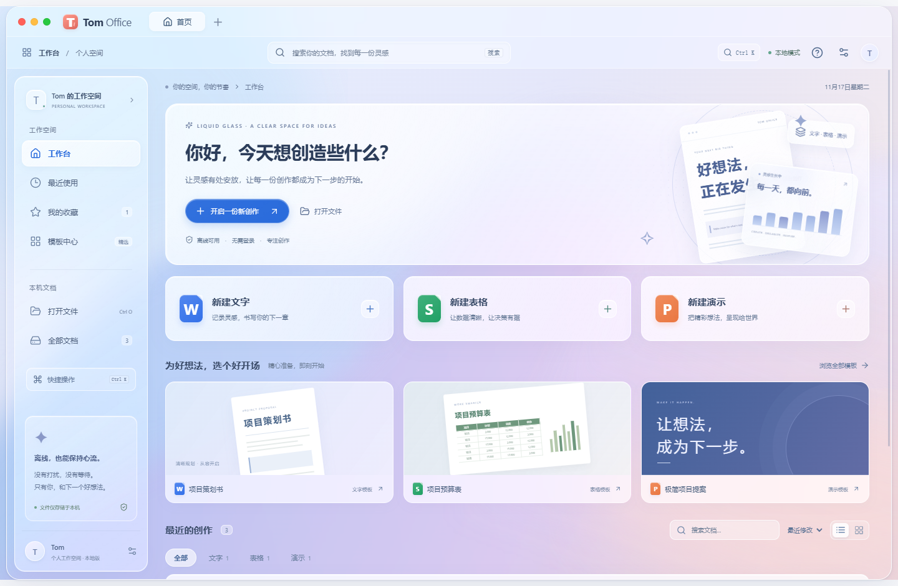
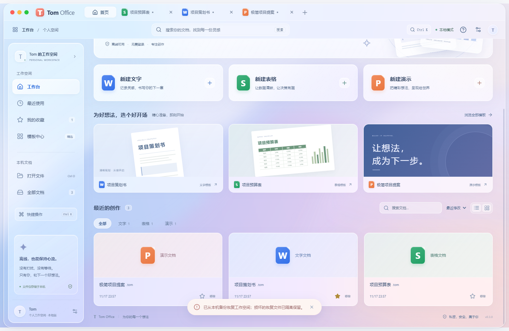
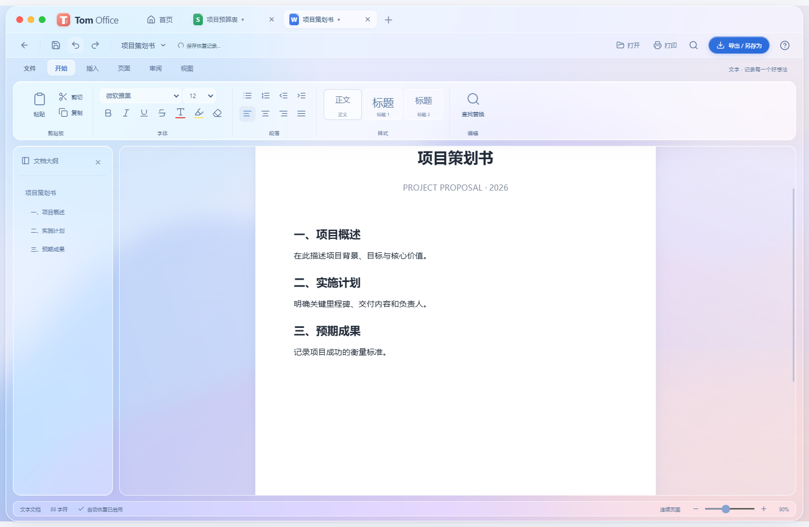
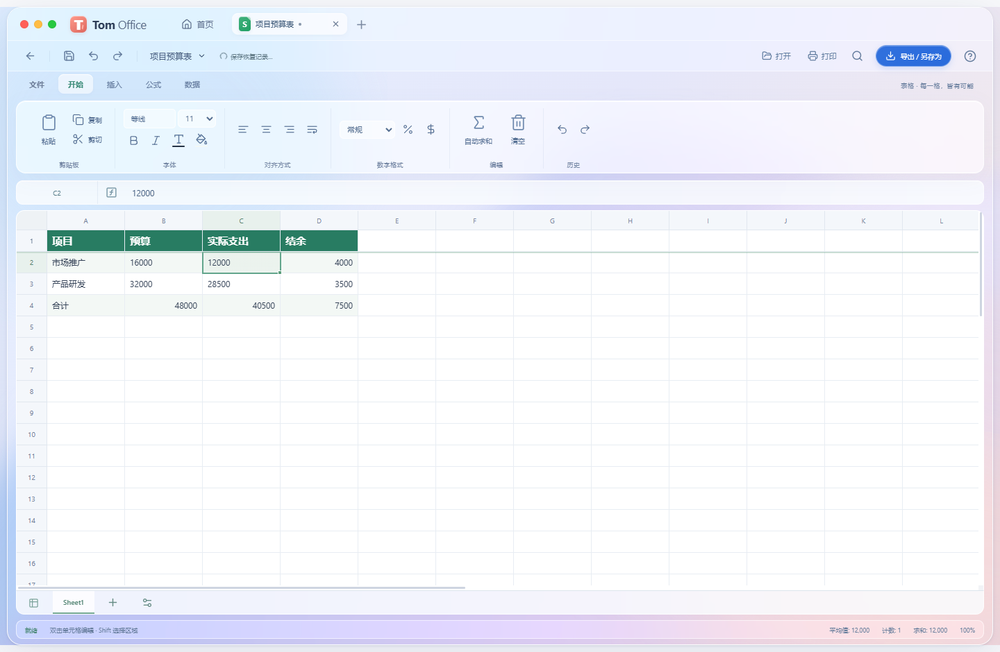
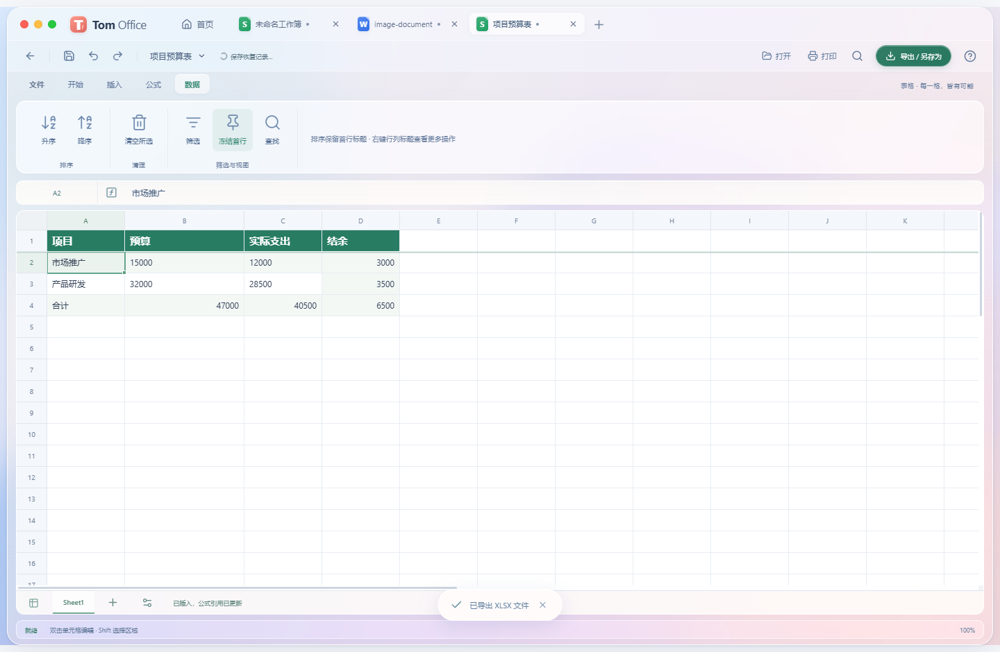
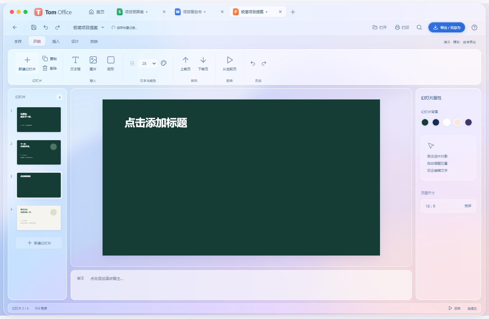
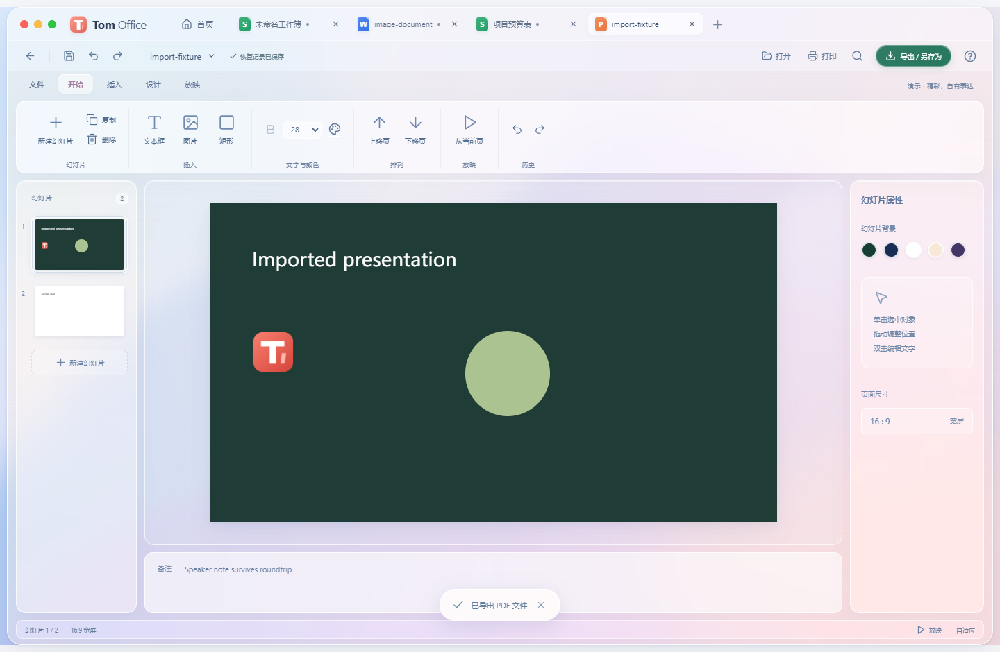
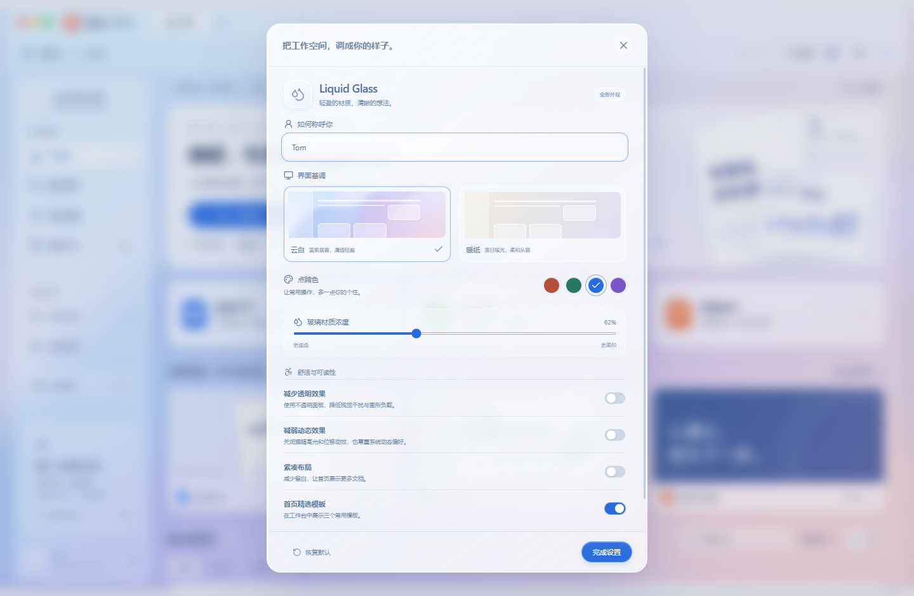
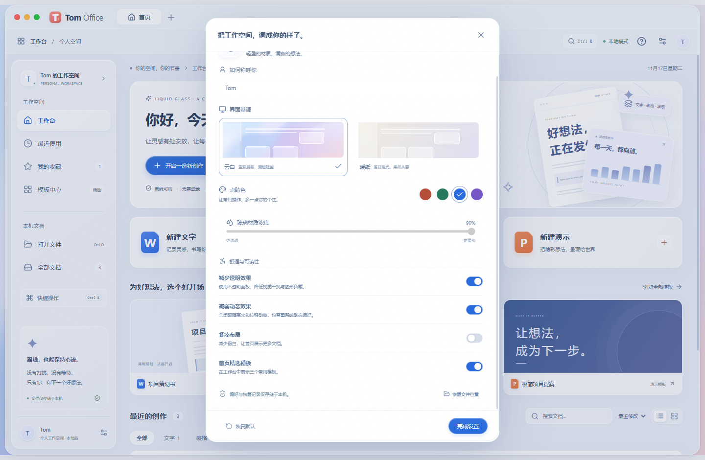

# Tom Office

可安装、离线可用的 **Windows 桌面办公套件**（文字 / 表格 / 演示）。当前版本 **0.3.0 · Liquid Glass**。

> 源码与界面截图来自本机项目。`node_modules`、`dist`、`release`、测试输出等大体积目录默认不入库。

## 界面预览

### 工作台首页

玻璃材质侧栏、三类快速新建入口与模板推荐。



### 文档网格视图

首页文档的网格展示、多标签与模板卡片。



### 文字编辑

标题、段落、列表等基础排版与本地文档编辑。



### 表格编辑

多工作表、公式栏与单元格编辑界面。



### 表格功能

筛选、冻结、格式等能力在同一窗口中的实际表现。



### 演示文稿

幻灯片编辑画布与对象工具区。



### 演示文稿导入

PPTX 导入后的编辑视图（自动化测试样本，非私人文件）。



### 外观与设置

基调、点睛色、玻璃浓度与减少动态效果等偏好。



### 玻璃材质设置

Liquid Glass 相关选项面板。



### 最小窗口

约 1050×720 最小窗口下的可读布局。


截图来自本机 Electron 自动化测试结果（`test-results/`），已复制到 `docs/screenshots/` 供 README 引用；原测试目录仍由 `.gitignore` 排除。

## 立即使用（Windows）

- **安装包**：若本地已构建，双击 `release/Tom-Office-Setup-0.3.0.exe`（`release/` 默认不入库）。
- **免安装**：双击项目根目录 `启动 Tom Office.cmd`，或运行 `release/win-unpacked/Tom Office.exe`（须保留完整 `win-unpacked` 文件夹，不能只复制单个 EXE）。
- 支持 **Windows 10/11 x64**。未做商业代码签名时，系统可能提示发布者未知。

`启动 Tom Office.cmd`：优先启动 `release\win-unpacked\Tom Office.exe`；否则需已有 `dist\index.html` 后执行 `npm start`。

## 0.3.0 · Liquid Glass（摘要）

- 应用内玻璃材质：蓝紫极光背景、半透明侧栏、悬浮工具区、圆角面板与限帧鼠标跟随高光。
- 左上角红/黄/绿控件对应关闭、最小化、最大化/还原（面向 Windows）。
- 玻璃浓度可调；提供“减少透明效果”“减弱动态效果”，并尊重系统减少动态与高对比度偏好。
- 文档纸张、表格单元格、幻灯片内容不套用玻璃滤镜；打印与导出不受外观滤镜影响。
- 修复输入框撤销、文字失焦撤销、演示重排页码、全屏 Esc，以及恢复记录异常等若干问题。

此处 Liquid Glass 为跨平台 CSS 材质实现，**不是** macOS 专有 API，也不是 Windows 桌面背景透视。视觉资源本地提供，不依赖外网。

## 功能概览

### 工作空间

- 半透明侧栏、快速新建、模板预览、文档列表/网格、排序筛选、收藏与搜索。
- 六个本地模板：项目策划书、会议纪要、项目预算表、任务进度看板、项目提案、季度汇报。
- 外观：云白/暖纸基调、点睛色、紧凑布局等；`Ctrl+K` 快捷操作；支持拖入文件导入。
- 安装时可注册 `.tom` 关联；支持系统打开文档、单实例切换与重启恢复。

### 文字

字体与段落样式、大纲、查找替换、图片与表格插入、DOCX / TXT / PDF 导出与原生打印等。**不是**完整 Word 替代品。

### 表格

多工作表、公式、排序筛选、冻结、XLSX / CSV / PDF 等。工作表编辑及 XLSX 导入上限约 **1000 行 × 100 列**；无合并单元格、图表、透视表。公式解析器不执行 JavaScript。已实现常用函数包括 `SUM`、`AVERAGE`、`MIN`、`MAX`、`IF`、`VLOOKUP`、`TODAY` 等（完整列表见 `src/formula.js` 与历史 README 备份）。

### 演示

幻灯片与对象编辑、主题背景、备注、放映；PPTX 导入导出与 16:9 PDF。导入**不是**完整 PowerPoint 渲染器（动画、母版完整还原、SmartArt、视频等暂不支持）。

## 保存、恢复与隐私

- **Ctrl+S** 默认保存 `.tom` 可编辑源文件；通用格式走导出 / 另存为。
- 工作空间偏好位于 Electron 用户数据目录；`workspace.json` / `.bak` / 损坏隔离文件用于恢复，**不是云备份服务**。
- 转换、PDF、恢复均在本机完成；无账号、无上传、无遥测。渲染进程启用沙盒与上下文隔离。

## 明确的兼容边界

独立实现，**不是 WPS / Microsoft Office**，不宣称全量功能或无损格式兼容。旧版 DOC / XLS / PPT、宏、云协作、完整排版引擎等不在范围内。打开文件上限约 50 MB；单张插入图片上限约 10 MB。导入复杂文件前请保留原件并检查导出结果。

## 开发与构建

建议 Node.js 24 与 npm。

```bash
npm install
npm run dev          # Electron 桌面开发窗口
npm run build        # 构建渲染端
npm start            # 使用已有 dist 启动
npm run dist         # Windows x64 NSIS 安装包
npm run pack         # 免安装应用文件夹
```

`npm run dev:web` 仅供界面调试；浏览器预览没有原生文件对话框、原生打印和直接 PDF 输出。

## 自动化验证

```bash
npm test               # 公式、模型、偏好与恢复等单测
npm run test:desktop   # 构建后 Electron 端到端
npm run test:packaged  # 对 win-unpacked 成品跑同类测试
```

测试使用隔离临时用户目录。本次材料准备**未重新执行**上述测试套件；截图沿用已有 `test-results` 产物。

## 仓库内容说明

**适合纳入版本库（推送前应显式暂存，不要 `git add .`）：**

- 源码：`src/`、`electron/`、`index.html`、`vite.config.js`
- 配置：`package.json`、`package-lock.json`、`.gitignore`
- 文档与截图：`README.md`、`docs/screenshots/*`、`启动 Tom Office.cmd`
- 资源：`assets/`（图标与 aurora 背景）
- 测试脚本：`tests/`（不含 `test-results` 输出）

**默认排除：** `node_modules/`、`dist/`、`release/`、`test-results/`、日志、`.env*` 等（见 `.gitignore`）。

未在本地新增 LICENSE（不擅自另选开源协议）。若 GitHub 创建仓库时已带 LICENSE，以远端为准，需合并策略时再处理。

## 代码位置（简表）

- `electron/main.cjs` / `preload.cjs` / `workspace.cjs`：窗口、菜单、文件授权、IO、打印与恢复
- `src/App.jsx`、`Home.jsx`、`Settings.jsx`、`CommandPalette.jsx`
- `src/DocEditor.jsx`、`SheetEditor.jsx`、`SlidesEditor.jsx`
- `src/formula.js`、`sheetOps.js`、`files.js`、`presentationIO.js`、`print.js`
- `src/styles.css`、`refinement.css`、`liquid-glass.css`、`useGlassLight.js`
